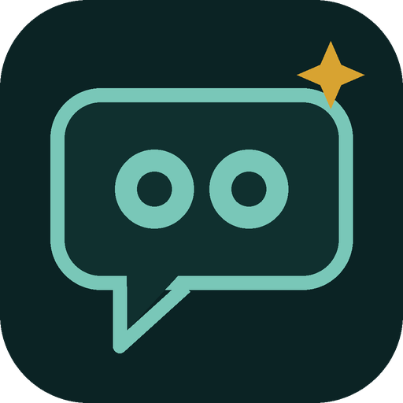

<p align="center"></p>

<h1 align="center">OiOi WordTalk · 词聊</h1>

<p align="center"><b>背单词，也聊单词。</b> 插画词卡 + AI 场景剧场 + 和 Dr. Anita 边学边聊 + 逻辑训练 + FSRS 记忆。</p>

<p align="center">
作者 Author：<b>Lixin Yin</b> · <a href="https://oioi-academy.com">OiOi MedAI Academy</a>（Dr. Anita）<br/>
<a href="https://2023anita.github.io/oioi-wordtalk/">在线体验 Live demo</a> ·
<a href="docs/IOS_RELEASE.md">iOS 上架指南</a> ·
<a href="#致谢--credits">致谢 Credits</a>
</p>

---

## 这是什么

一个**纯前端、本地优先**的雅思词汇 App（PWA，可加到 iPhone 主屏幕）。它保留了开源项目 Word Atlas 的 7,298 个插画词条、英美发音、星图和 FSRS 复习，并加入用 AI 把单词“用起来”的练习：

| 模块 | 做什么 |
| --- | --- |
| 📅 **今日计划** | 新词 → 场景剧场 → 和 Dr. Anita 聊 → 快速复习，四步一条线 |
| 🎭 **场景剧场 Scene Theater** | 选今天 5–8 个词 + 一个场景（机场、租房、看医生、咖啡馆面试、医院手术室、学术会议…），AI 写约 150 词小故事，词高亮可点开词卡插画；再做 3 题：理解、填空、“为什么是 A 不是 B” |
| 💬 **边学边聊 Chat** | 和 Dr. Anita 角色扮演；任务词以卡片显示；模型用 JSON 判定你是否**用对**了目标词 → 点亮星星并记一次 FSRS 复习；每轮给出正误与更自然的说法；支持 Web Speech 语音输入、词库真人发音 |
| 🧠 **逻辑训练 Logic** | 词网（近反义、搭配、词族 + AI 扩展）、雅思大作文论证链（论点→理由→证据→让步→结论，逐步打分）、辩论模式（指出逻辑漏洞）、易混词辨析（用词库 tip） |
| 🔁 **FSRS 扩展** | 复习记录带来源：卡片 / 场景测验 / 对话使用 / 论证；同一词同一来源每天只计一次 |
| 🔑 **自带模型 BYOK** | MiniMax（中国站 / Global）、DeepSeek、通义千问（DashScope 兼容模式）、**OpenRouter（含免费模型）**、OpenAI、任意 OpenAI 兼容地址；Key 只存在本机；生成内容缓存在 IndexedDB；无 Key 时有**离线演示模式** |

没有账号、没有服务器、没有统计追踪。详见 [隐私政策](https://2023anita.github.io/oioi-wordtalk/#/privacy)。

## 快速开始

```bash
npm ci
npm run dev            # http://localhost:5188/oioi-wordtalk/
npm test               # 单元测试
npm run check:atlas    # 词库与媒体完整性校验
npm run build          # 生产构建（默认 base /oioi-wordtalk/）
npm run build:check    # 快速构建（不复制 640 MB 媒体）
```

打开 App → 右上角 <kbd>CPU</kbd> 图标「模型设置」→ 选服务商、粘贴你自己的 API Key → 测试连接。

> 2026-11-22 检查过：MiniMax、DeepSeek、DashScope、OpenRouter、OpenAI 都允许浏览器跨域直连。如果你的网络拦截了直连，可自行部署 [`proxy/`](proxy/) 里的 Cloudflare Worker（可选，未部署）。

### 免费用：OpenRouter

没有付费 Key 也能用真模型：在 [openrouter.ai/keys](https://openrouter.ai/keys) 免费注册拿一个 Key，服务商选「OpenRouter（含免费模型）」。

- 默认模型 `openrouter/free`（自动挑一个可用的免费模型）；模型列表实时读取 OpenRouter，默认「只看免费」，也可以直接输入任意模型 ID。
- 免费模型有每分钟和每天的次数上限（从未充值的账户约 50 次/天，充值过 ≥10 美元约 1000 次/天）。「测试连接」成功后会显示今天已用 / 上限。遇到限流（429）会自动改用 `openrouter/free` 重试一次，仍失败时给出中文提示。
- 生成的故事、词网和辨析题会缓存在本机，重复打开不再消耗次数。
- 隐私：内容会发给 OpenRouter 及其背后的模型提供方。**部分免费模型的提供方可能记录输入用于训练，请勿输入隐私信息。**

## 部署

- **网页 / PWA**：推送到 `main` 后由 [`.github/workflows/pages.yml`](.github/workflows/pages.yml) 自动部署到 GitHub Pages（会检查 1 GB 上限）。
- **iOS**：已配置 Capacitor（`com.oioiacademy.wordtalk`）+ fastlane + 手动触发的 TestFlight 工作流，默认禁用。交 Apple 开发者年费后按 [docs/IOS_RELEASE.md](docs/IOS_RELEASE.md) 操作。

## 目录

```
src/ai/          模型层：服务商预设、OpenAI 兼容客户端、JSON 校验、缓存、离线演示、提示词
src/pages/       今日 · 剧场 · 聊天 · 逻辑 · 图鉴 · 练习 · 我的 · 模型设置 · 隐私 · 致谢
src/store/       学习进度、FSRS（ts-fsrs）、复习来源记录
public/atlas/    词库分块、插画、录音（CC BY 4.0，来自 Word Atlas）
proxy/           可选 Cloudflare Worker 代理
fastlane/        iOS 签名与 TestFlight 上传
```

## 致谢 / Credits

- 本项目基于 **[词光 Word Atlas](https://github.com/designfuchen/word-atlas)**（作者 **designfuchen**）二次开发。衷心感谢原作者把代码与词库开源。
- **代码**：MIT。见 [LICENSE](LICENSE)，同时保留原项目版权声明（Word Atlas contributors）。
- **词库、插画、单词与例句录音**：© Word Atlas contributors（词光），[CC BY 4.0](https://creativecommons.org/licenses/by/4.0/)；**本项目对其做了修改与扩展**（改名换色的界面、AI 场景故事与练习等）。见 [CONTENT_LICENSE.md](CONTENT_LICENSE.md)。
- **界面音效与配乐**：原项目录制的音效和音乐不在 CC BY 范围内，本项目已全部移除，改为浏览器实时合成的提示音。
- 字体 Fraunces（SIL OFL 1.1）。配色参考 [OiOi MedAI Academy](https://oioi-academy.com)。
- 本项目是独立作品，**与原作者及官方「词光」App 无关，也不代表其认可或背书**；不是官方雅思产品。

English: Bring your own key for MiniMax, DeepSeek, Qwen (DashScope), **OpenRouter (incl. free models)**, OpenAI or any OpenAI-compatible endpoint. With OpenRouter you can start free: get a key at https://openrouter.ai/keys, keep the default `openrouter/free` or pick any `:free` model from the live list. Free models have per-minute and per-day request caps (about 50/day for accounts that never bought credits, about 1,000/day after buying ≥ $10); the app shows today's usage after "Test connection" and retries a rate-limited request once on `openrouter/free`. Text goes to OpenRouter and the underlying provider; some free-model providers may log prompts for training, so do not enter private information.

OiOi WordTalk is built on the open-source Word Atlas (词光) by designfuchen. Code is MIT (original copyright notice retained). Dataset, illustrations and word audio are © Word Atlas contributors under CC BY 4.0 and have been modified and extended here. Not affiliated with or endorsed by the original author.

## License

Code: [MIT](LICENSE) · Content: [CC BY 4.0](CONTENT_LICENSE.md) · © 2026 Lixin Yin (OiOi MedAI Academy)
